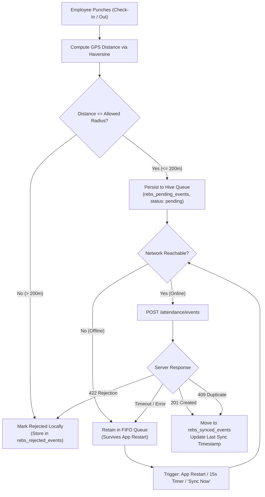

# REBS HRMS — Mobile Employee Application

[](https://flutter.dev)
[](https://dart.dev)
[]()
[](https://pub.dev/packages/hive)
[](https://nodejs.org)
[-brightgreen)]()
[]()

**REBS HRMS** is an enterprise-grade employee attendance, leave management, and corporate directory mobile application built with **Flutter** and powered by a dedicated **Node.js / Express.js REST API**. Designed with an **offline-first architecture**, the application guarantees uninterrupted punch operations even in zero-connectivity environments, featuring automated background synchronization, GPS geofencing, and idempotent deduplication.

---

## Table of Contents

- [Key Features](#key-features)
- [Architecture & Design](#architecture--design)
- [Offline-First Sync Flow](#offline-first-sync-flow)
- [Technology Stack](#technology-stack)
- [Directory Structure](#directory-structure)
- [GPS Geofencing Configuration](#gps-geofencing-configuration)
- [REST API Reference](#rest-api-reference)
- [Getting Started](#getting-started)
- [Testing & Quality Assurance](#testing--quality-assurance)

---

## Key Features

### 1. Dashboard & Corporate Identity
- **Employee Overview**: Live greeting, corporate designation, department, and initialed avatar badge.
- **Punch Status Card**: Real-time indication of current shift status (`Not Checked In`, `Checked In`, `Checked Out`), check-in/out timestamps, and accrued working hours.
- **Monthly Summary Metrics**: Present, Late, Absent, and Half-day tallies.
- **Leave Balances**: Quick-view casual and sick leave quotas with progress indicators.

### 2. Attendance & GPS Geofence Verification
- **One-Tap Punch**: Streamlined check-in and check-out actions with single-tap operation.
- **Real-Time GPS Validation**: High-accuracy distance calculation using the geodesic **Haversine formula**.
- **Configurable Perimeter**: Configurable geofence radius (default: `200.0m`) with visual proximity progress bar.
- **Interactive Telemetry Preview**: In-app debug controls to simulate location changes (`Granted`, `Outside Radius`, `GPS Unavailable`, `Permission Denied`).
- **Monthly Attendance Register**: Grouped daily registers, status badges, working hour breakdowns, and sync indicators.

### 3. Offline Storage & Background Synchronization
- **Hive NoSQL Storage**: Dedicated local key-value boxes for pending events, confirmed events, rejected punches, sync metadata, and dashboard cache.
- **Guaranteed Punch Order (FIFO)**: Queued punches maintain chronological event sequence across device restarts.
- **Instant Online Punch**: Automatic direct-to-server sync when network connectivity is available.
- **Automatic Sync Recovery**:
  - **On App Launch**: Detects pending records upon app launch and drains the queue immediately.
  - **Background Monitor**: Lightweight 15-second heartbeat detects restored internet access and auto-syncs.
- **Idempotency & Deduplication**: Employs UUIDs for every event; server returns `HTTP 409 Conflict` on duplicates, handled seamlessly by the client without duplicating entries.
- **Offline Geofence Rejection**: Punches outside the allowed radius are validated and rejected locally even without internet.
- **Sync Management Screen**: Telemetry dashboard displaying pending, synced, and rejected queues with a manual **Sync Now** trigger.

### 4. Leave Management
- **Balance Tracking**: Casual leave, sick leave, and total available allowances.
- **Leave Application**: Interactive date-range picker, reason input with validation, and balance checks.
- **Application History**: Complete register of past applications with `Approved`, `Pending`, and `Rejected` statuses.

---

## Architecture & Design

The application follows **Clean Architecture** with the **BLoC (Business Logic Component)** pattern, separating UI, domain business logic, and data layers:

```
┌─────────────────────────────────────────────────────────────┐
│                    Presentation Layer                       │
│  Screens (UI) ──> Presentation Widgets ──> Form Controls   │
└──────────────────────────────┬──────────────────────────────┘
                               │ Dispatches Events / Listens States
                               ▼
┌─────────────────────────────────────────────────────────────┐
│                     BLoC State Layer                        │
│   DashboardBloc  │  AttendanceBloc  │  LeaveBloc  │ SyncBloc│
└──────────────────────────────┬──────────────────────────────┘
                               │ Invokes Use Cases / Repository
                               ▼
┌─────────────────────────────────────────────────────────────┐
│                     Repository Layer                        │
│ DashboardRepo │ AttendanceRepo │ LeaveRepo │ SyncRepo       │
└───────────────┬───────────────────────────────┬─────────────┘
                │                               │
                ▼                               ▼
┌───────────────────────────────┐ ┌───────────────────────────┐
│     Local Storage (Hive)      │ │   Remote API (HTTP Client)│
│ • rebs_pending_events.hive    │ │ • ApiClient (REST)        │
│ • rebs_synced_events.hive     │ │ • Unified ApiResponse<T> │
│ • rebs_rejected_events.hive   │ │ • Node.js Mock API (:3000)│
│ • rebs_app_cache.hive         │ │                           │
└───────────────────────────────┘ └───────────────────────────┘
```

### Strict Code Constraints
- **Maximum 150 lines per Dart file**: Strictly enforced across all 114 source files in `lib/` and `test/` for enhanced modularity, readability, and maintainability.
- **Zero Static Analysis Issues**: Clean `flutter analyze` report with zero warnings or errors.

---

## Offline-First Sync Flow



---

## Technology Stack

| Layer | Technology | Purpose |
|---|---|---|
| **Framework** | Flutter 3.10+ / Dart 3.10+ | Cross-platform mobile client |
| **State Management** | `flutter_bloc` ^8.1.6, `bloc` ^8.1.4 | Reactive unidirectional state architecture |
| **Local Storage** | `hive` ^2.2.3, `hive_flutter` ^1.1.0 | Fast, lightweight persistent NoSQL database |
| **Networking** | `http` ^1.2.2 | REST HTTP client with timeout and header management |
| **Identifiers** | `uuid` ^4.5.1 | RFC4122 v4 unique identifier generation |
| **Backend API** | Node.js, Express.js 4.19+ | REST API server with geofencing & mock database |
| **Testing** | `flutter_test`, `http/testing` | Unit, widget, and end-to-end integration tests |

---

## Directory Structure

```text
attendance_register_app/
├── lib/
│   ├── main.dart                                # Application entry point & provider tree
│   ├── core/
│   │   ├── constants/
│   │   │   ├── api_constants.dart               # Base URLs & endpoint routes
│   │   │   ├── app_constants.dart               # Geofence coordinates & UI tokens (Single Source of Truth)
│   │   │   └── app_strings.dart                 # User-facing string literals
│   │   ├── errors/
│   │   │   └── exceptions.dart                  # Custom domain exceptions
│   │   ├── network/
│   │   │   ├── api_client.dart                  # Reusable HTTP client wrapper
│   │   │   └── api_response.dart                # Generic StatusCode: 6000 envelope
│   │   ├── theme/
│   │   │   ├── app_colors.dart                  # Corporate color palette tokens
│   │   │   ├── app_theme.dart                   # Light ThemeData configuration
│   │   │   └── app_typography.dart              # Standardized text styles
│   │   └── utils/
│   │       ├── date_formatter.dart              # Formats ISO dates & timestamps
│   │       ├── duration_formatter.dart          # Formats working duration
│   │       └── location_calculator.dart        # Haversine distance calculator
│   ├── features/
│   │   ├── attendance/                          # Attendance & Geofence Feature
│   │   │   ├── bloc/                            # AttendanceBloc, Events, States
│   │   │   ├── data/repositories/               # AttendanceRepository
│   │   │   ├── data/services/                   # AttendanceApiService
│   │   │   └── presentation/screens/            # Overview, History, and Event Details screens
│   │   ├── dashboard/                           # Corporate Dashboard Feature
│   │   │   ├── bloc/                            # DashboardBloc, Events, States
│   │   │   ├── data/repositories/               # DashboardRepository
│   │   │   ├── data/services/                   # EmployeeApiService
│   │   │   └── presentation/screens/            # DashboardScreen & metric widgets
│   │   ├── leave/                               # Leave Management Feature
│   │   │   ├── bloc/                            # LeaveBloc, Events, States
│   │   │   ├── data/repositories/               # LeaveRepository
│   │   │   ├── data/services/                   # LeaveApiService
│   │   │   └── presentation/screens/            # LeaveManagementScreen & ApplyLeaveScreen
│   │   ├── navigation/                          # Root App Shell & Routing
│   │   │   └── presentation/screens/            # MainNavigationScreen & BottomNavBar
│   │   └── sync/                                # Offline Sync & Queue Feature
│   │       ├── bloc/                            # SyncBloc (with 15s AutoSync monitor)
│   │       ├── data/repositories/               # SyncRepository (Queue draining)
│   │       ├── data/services/                   # SyncStorageService & CacheStorageService
│   │       └── presentation/screens/            # SyncManagementScreen
│   └── shared/
│       ├── models/                              # Domain models (Employee, Attendance, Leave)
│       └── widgets/                             # Reusable buttons, badges, cards, dialogs
├── mock_api/                                    # Node.js Mock REST API Backend
│   ├── server.js                                # Express server entry point (:3000)
│   ├── test_api.js                              # Backend automated integration test suite
│   ├── package.json                             # Dependencies (express, cors, uuid)
│   └── src/
│       ├── config/index.js                      # Office geofence coordinates & server config
│       ├── controllers/                         # Route controllers
│       ├── data/database.json                   # JSON mock database
│       ├── middleware/                          # Response handler & logger
│       ├── routes/                              # REST route declarations
│       ├── services/                            # Business logic (attendance, leave, DB)
│       └── utils/                               # Distance calculation & date formatting
├── test/                                        # 27 Automated Flutter Tests
│   ├── api_response_test.dart
│   ├── blocs_test.dart
│   ├── dashboard_integration_ui_test.dart
│   ├── employee_api_test.dart
│   ├── live_offline_demo_test.dart             # Live end-to-end 10-step offline demo
│   ├── models_test.dart
│   ├── offline_punch_test.dart                  # Offline persistence & geofence rejection
│   ├── sync_idempotency_test.dart               # HTTP 409 deduplication & retry testing
│   └── widget_test.dart
├── API_DOCUMENTATION.md                         # Complete API specification document
└── HRMS_Postman_Collection.json                 # Postman Collection v2.1
```

---

## GPS Geofencing Configuration

The application enforces a **Single Source of Truth** for the office location across the Flutter client and the backend:

| Property | Value | Description |
|---|---|---|
| **Office Name** | `REBS HQ (Temporary Site)` | Active office campus site |
| **Latitude** | `10.6940374` | Configured office latitude |
| **Longitude** | `76.7345539` | Configured office longitude |
| **Allowed Radius** | `200.0 meters` | Geofence perimeter threshold (configurable) |

### Modifying Geofence Settings
- **Client**: Update `AppConstants.officeLatitude`, `AppConstants.officeLongitude`, or `AppConstants.allowedRadiusMeters` in [app_constants.dart](file:///Users/nandinin/personal_projects/attendance_register_app/lib/core/constants/app_constants.dart).
- **Backend**: Update `officeLocation` in [mock_api/src/config/index.js](file:///Users/nandinin/personal_projects/attendance_register_app/mock_api/src/config/index.js).

---

## REST API Reference

The backend uses a standard response envelope with `StatusCode: 6000` (Success) and `StatusCode: 6001` (Business Error).

| Method | Endpoint | Description | Status Code |
|---|---|---|---|
| `GET` | `/health` | API service health & uptime check | `200 OK` |
| `GET` | `/employee/me` | Logged-in employee profile (`Nandini N`, `EMP-2048`) | `200 OK` |
| `GET` | `/employee` | List all corporate employees | `200 OK` |
| `GET` | `/attendance?month=YYYY-MM` | Monthly attendance register with daily status | `200 OK` |
| `POST` | `/attendance/events` | Record check-in / check-out with geofence validation | `201 Created` / `422 Unprocessable` / `409 Conflict` |
| `GET` | `/leave/balance` | Casual & sick leave allowance quotas | `200 OK` |
| `GET` | `/leave/requests` | History of submitted leave applications | `200 OK` |
| `POST` | `/leave/requests` | Submit leave request with duration & overlap validation | `201 Created` / `422 Unprocessable` / `409 Conflict` |

> For complete payload examples, query parameters, and error schemas, see [API_DOCUMENTATION.md](file:///Users/nandinin/personal_projects/attendance_register_app/API_DOCUMENTATION.md).

---

## Getting Started

### Prerequisites
- [Flutter SDK](https://docs.flutter.dev/get-started/install) (`>= 3.10.0`)
- [Node.js](https://nodejs.org/) (`>= 18.0.0`) & npm
- A connected physical device, Android Emulator, macOS desktop, or Chrome browser.

### 1. Start the Mock REST API Server
```bash
# Navigate to the backend directory
cd mock_api

# Install backend dependencies (first time only)
npm install

# Start the server
npm start
# Output: REBS HRMS Mock REST API Server running on port 3000
```

Verify backend health in your terminal:
```bash
curl http://localhost:3000/health
```

### 2. Run the Flutter Application
Open a second terminal window in the project root:

```bash
# Fetch Flutter packages
flutter pub get

# Run on macOS desktop
flutter run -d macos

# Or run on Chrome
flutter run -d chrome

# Or run on Android emulator (uses 10.0.2.2 automatically)
flutter run -d emulator-5554
```

---

## Testing & Quality Assurance

### Run Flutter Test Suite
Execute all 27 automated tests:
```bash
flutter test
```

### Run Full Static Analysis
Verify zero lint warnings or formatting issues:
```bash
flutter analyze
```

### Verify Line-Count Constraints
Ensure all Dart source files are strictly $\le$ 150 lines:
```bash
find lib test -name "*.dart" -exec wc -l {} + | awk '$1 > 150 {print $0}'
# Output: (zero files exceeding 150 lines)
```

### Postman Integration
Import [HRMS_Postman_Collection.json](file:///Users/nandinin/personal_projects/attendance_register_app/HRMS_Postman_Collection.json) into Postman to test all endpoints interactively with pre-configured environment variables and validation scripts.

---

## License

This project is licensed under the MIT License for internal evaluation and development.
# attendance_app_task_NANDINI
