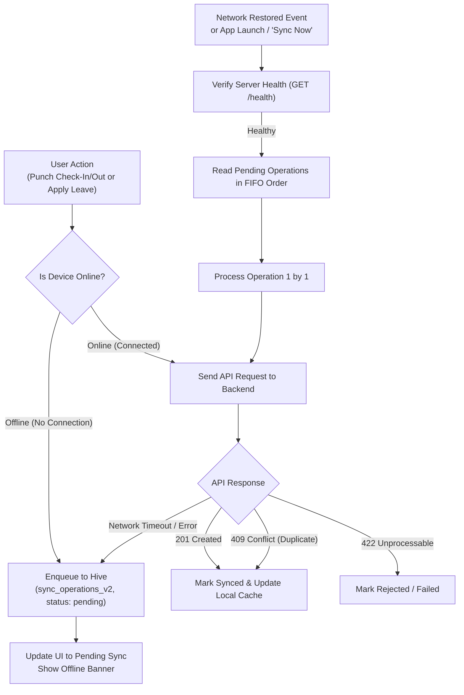

# REBS HRMS — Mobile Employee Application

[](https://flutter.dev)
[](https://dart.dev)
[]()
[](https://pub.dev/packages/hive)
[](https://nodejs.org)
[-brightgreen)]()
[]()

**REBS HRMS** is an enterprise-grade employee attendance, leave management, and corporate dashboard mobile application built with **Flutter** and powered by a dedicated **Node.js / Express.js REST API**. Engineered with an **offline-first architecture**, the application guarantees uninterrupted punch and leave operations even in zero-connectivity environments, featuring automatic background synchronization, GPS geofencing, FIFO queue ordering, and idempotent deduplication.

---

## Table of Contents

- [1. Architecture & Design](#1-architecture--design)
- [2. Setup & Installation](#2-setup--installation)
- [3. Assumptions & Domain Rules](#3-assumptions--domain-rules)
- [4. Completed Features](#4-completed-features)
- [5. Offline Storage, Sync & Idempotency Pipeline](#5-offline-storage-sync--idempotency-pipeline)
- [6. Reviewer Testing & Location Simulation](#6-reviewer-testing--location-simulation)
- [7. Limitations](#7-limitations)
- [8. Time Spent](#8-time-spent)

---

## 1. Architecture & Design

The project strictly follows **Clean Architecture** combined with the **BLoC (Business Logic Component)** pattern to ensure unidirectional data flow, testability, and total decoupling between UI and business rules.

```
┌─────────────────────────────────────────────────────────────┐
│                    Presentation Layer                       │
│  Screens (UI) ──> Presentation Widgets ──> Form Controls   │
└──────────────────────────────┬──────────────────────────────┘
                               │ Dispatches Events / Listens States
                               ▼
┌─────────────────────────────────────────────────────────────┐
│                     BLoC State Layer                        │
│   DashboardBloc  │  AttendanceBloc  │  LeaveBloc  │ SyncBloc│
└──────────────────────────────┬──────────────────────────────┘
                               │ Invokes Repositories
                               ▼
┌─────────────────────────────────────────────────────────────┐
│                     Repository Layer                        │
│ DashboardRepo │ AttendanceRepo │ LeaveRepo │ SyncRepo       │
└───────────────┬───────────────────────────────┬─────────────┘
                │                               │
                ▼                               ▼
┌───────────────────────────────┐ ┌───────────────────────────┐
│     Local Storage (Hive)      │ │   Remote API (HTTP Client)│
│ • sync_operations_v2.hive     │ │ • ApiClient (REST wrapper)│
│ • rebs_pending_events.hive    │ │ • Unified ApiResponse<T> │
│ • rebs_synced_events.hive     │ │ • Node.js Mock API (:3000)│
│ • rebs_rejected_events.hive   │ │                           │
│ • rebs_app_cache.hive         │ │                           │
└───────────────────────────────┘ └───────────────────────────┘
```

### Architectural Principles

1. **Unidirectional Data Flow (UDF)**:
   - UI dispatches events to BLoCs (`AttendanceEvent`, `LeaveEvent`, `DashboardEvent`, `SyncEvent`).
   - BLoCs interact with repositories and emit immutable states (`Initial`, `Loading`, `Loaded`, `Error`).
   - UI rebuilds reactively using `BlocBuilder` and `BlocConsumer`.
2. **Single Source of Truth for Offline Queue**:
   - All pending operations (Check-in, Check-out, Leave Applications) enter a single persistent queue managed by `SyncStorageService` (`sync_operations_v2` Hive box).
   - Sync Management screen and Attendance/Leave screens observe the exact same queue state.
3. **Idempotency & Deduplication**:
   - Every operation is assigned a client-generated UUID (`eventId` / `operationId`) and an ISO UTC timestamp.
   - Server handles duplicate submissions gracefully by responding with `HTTP 409 Conflict`, which the sync engine treats as an idempotent success, clearing the pending queue without generating duplicates.
4. **Geodesic Haversine Calculation**:
   - Real-world distance from the configured corporate site (`10.6940374, 76.7345539`) is computed both client-side (for instant UI feedback) and server-side (for security enforcement).
5. **Strict File Line-Length Constraint ($\le 150$ lines)**:
   - Every single Dart file across `lib/` and `test/` (all 114+ files) strictly adheres to $\le 150$ lines of code, enforcing modularity, single-responsibility principle, and maintainability.

---

## 2. Setup & Installation

### Prerequisites
- **Flutter SDK**: `>= 3.10.0` ([Installation Guide](https://docs.flutter.dev/get-started/install))
- **Dart SDK**: `>= 3.10.0`
- **Node.js**: `>= 18.0.0` & npm ([Download Node.js](https://nodejs.org/))
- **Target Platform**: macOS Desktop, Android Emulator / Device, iOS Simulator, or Chrome.

---

### Step 1: Start the Mock REST API Server

The application relies on a dedicated Node.js / Express backend with simulated network latency, geofence validation, and persistence. For complete multi-platform instructions (including real Android device testing and cURL samples), see [MOCK_API_SETUP_INSTRUCTIONS.md](file:///Users/nandinin/personal_projects/attendance_register_app/MOCK_API_SETUP_INSTRUCTIONS.md).

```bash
# Navigate to mock backend directory
cd mock_api

# Install dependencies (first time only)
npm install

# Start the mock server (runs on port 3000)
npm start
```

Verify backend health in your terminal:
```bash
curl http://localhost:3000/health
# Response: {"status":"healthy","uptime":...,"timestamp":...}
```

---

### Step 2: Configure & Run the Flutter Application

Open a second terminal window at the project root:

```bash
# Install Flutter dependencies
flutter pub get
```

#### Run on macOS Desktop (Recommended for fast testing)
```bash
flutter run -d macos
```

#### Run on Android Emulator
```bash
# Automatically resolves localhost to 10.0.2.2 for Android
flutter run -d emulator-5554
```

#### Run on Real Android Physical Device
When running on a physical Android phone connected via USB:
```bash
# Reverse the mock API port to the phone
adb reverse tcp:3000 tcp:3000

# Run the app
flutter run -d <device-id>
```
*Note: If testing over Wi-Fi without USB cable, update `androidBaseUrl` in `lib/core/constants/api_constants.dart` to your computer's local LAN IP (e.g., `http://192.168.1.X:3000`).*

#### Run on iOS Simulator
```bash
flutter run -d iPhone
```

---

### Step 3: Run Automated Tests

Execute the complete suite of **61 automated tests**:

```bash
# Run all tests
flutter test

# Run the 5 mandatory assignment tests specifically
flutter test test/required_assignment_tests_test.dart
```

### Step 4: Verify Static Analysis & Code Quality
```bash
# Run Flutter analyzer (0 issues found)
flutter analyze

# Verify file line-count limits (all files <= 150 lines)
find lib test -name "*.dart" -exec wc -l {} + | awk '$1 > 150 {print $0}'
```

---

## 3. Assumptions & Domain Rules

1. **Preconfigured Employee Profile**:
   - Login and user authentication are outside the scope of this assignment.
   - The app uses one preconfigured employee: **Nandini N** (`EMP-2048`, Department: `Engineering`, Role: `Senior Mobile Engineer`).
2. **Attendance Session Model**:
   - Assumes **one attendance session per working day** (one check-in and one check-out).
   - Check-out is permitted only after check-in has been completed.
   - Overnight shifts or split shifts are outside assignment scope.
3. **Leave Rules & Calendar Days**:
   - All calendar days count as leave days (weekends and holidays are ignored per specification).
   - Start date cannot be before the current company date (no backdated leave).
   - End date cannot be before start date.
   - Leave reason must contain at least 10 non-whitespace characters.
   - Requested days cannot exceed available balance.
   - Dates cannot overlap an existing `Pending` or `Approved` leave request.
4. **Geofence Parameters**:
   - Configured Office Coordinates: Latitude `10.6940374`, Longitude `76.7345539`.
   - Permitted Geofence Radius: `200.0 meters`.
5. **Background Execution Scope**:
   - Background execution while the app is terminated is outside the assignment scope.
   - Automatic sync is triggered reactively on:
     - Network connectivity restoration (with server health reachability check).
     - App launch / cold start.
     - App lifecycle resume from background.
     - Manual "Sync Now" trigger in the UI.
6. **Zero-Trust Device Validation**:
   - Device-side validation improves user experience and provides instant feedback.
   - The production server must always repeat all checks (geofence, idempotency, punch sequence, and leave balance locks).

---

## 4. Completed Features

### 1. Employee Dashboard
- **Employee Identity Card**: Name, employee ID, corporate role, department, and avatar badge.
- **Real-Time Shift Status**: Live shift state (`Not Checked In`, `Checked In`, `Checked Out`), formatted check-in/out timestamps, and elapsed working duration timer.
- **Available Leave Balance**: Visual progress indicators for Casual Leave and Sick Leave balances.
- **Latest 5 Attendance Records**: Clean overview of the most recent punch history.
- **Resilient States**: Shimmer skeleton loading screen, empty state, error state, and offline indicator banner.

### 2. Attendance Check-In & Check-Out
- **Single-Tap Actions**: Dedicated Check-In and Check-Out actions that react to current shift status.
- **GPS Geofence Enforcement**: Permitted only within 200m of the office location.
- **Interactive Reviewer Location Simulator**:
  - Located in the AppBar popup menu (`Reviewer GPS Simulator`).
  - Allows reviewers to test:
    1. `Inside Office (48m)` — allows check-in/out.
    2. `Outside Office (385m)` — shows perimeter warning banner and blocks punch.
    3. `GPS Unavailable` — simulates disabled location services.
    4. `Permission Denied` — simulates user denying location access.
    5. `Permission Permanently Denied` — simulates user selecting "Never Ask Again".
- **Duplicate Prevention**: Drops rapid duplicate taps and rejects invalid transitions.

### 3. Streamlined Attendance History
- Clutter-free monthly attendance register.
- Displays date, status chip (`Present`, `Checked In`, `Late`, `Half Day`), check-in time, check-out time, working duration, and sync status badge (`Synced`, `Pending`).

### 4. Leave Management & Leave Application
- **Leave Balances**: Real-time display of casual, sick, and total leave quotas.
- **Application Form**:
  - Leave type selector (`Casual` or `Sick`).
  - Interactive Start Date and End Date calendar pickers with validation.
  - Reason text input with live character counter.
  - Submit button dynamically locks until all validation rules pass.
- **Validation Rules**:
  - Start date cannot be before current company date.
  - End date cannot be before start date.
  - Reason must contain $\ge 10$ non-whitespace characters.
  - Requested days cannot exceed available balance.
  - Dates cannot overlap an existing `Pending` or `Approved` request.
- **Status Filtering**: Filter requests by `All`, `Pending`, `Approved`, and `Rejected`.
- **Offline Resilience**: Previously loaded requests remain viewable offline from cache.

### 5. Unified Offline Queue & Sync Management
- **Unified Persistent Queue**: All offline operations (Check-in, Check-out, Leave Applications) are stored in a single Hive-backed persistent queue.
- **Sync Management Screen**:
  - Live counts of `Pending`, `Syncing`, `Synced`, and `Failed` operations.
  - Operation type indicators, request timestamps, retry counters, and error messages.
  - Manual **Sync Now** action button.
- **Automatic Queue Draining**: Sequentially processes pending items in strict FIFO order upon reconnection.

---

## 5. Offline Storage, Sync & Idempotency Pipeline



### Event Identity & Idempotency Strategy
- Every attendance punch and leave application generates a client UUID (`eventId` / `operationId`) via `uuid.v4()`.
- If a network timeout occurs where the server processed the event but the client never received the response, the client will retry synchronization later.
- When retried, the backend recognizes the existing `eventId` and returns `HTTP 409 Conflict` with `{"StatusCode": 6001, "message": {"body": "Duplicate event."}}`.
- The client's `SyncRepository` treats `409 Conflict` as an **idempotent success**, marks the item as synced, and safely removes it from the pending queue. This guarantees that duplicate server records are never created.

---

## 6. Reviewer Testing & Location Simulation

### Location Simulation for Reviewers
Because reviewers may not be physically located at `10.6940374, 76.7345539`, an interactive simulation controller is built directly into the app:
1. Open the **Attendance** screen.
2. Tap the `...` menu in the top-right of the AppBar.
3. Select any simulation mode:
   - **Inside Office (48m)**: Enables punch buttons.
   - **Outside Office (385m)**: Disables punch buttons and shows distance warning.
   - **GPS Unavailable / Permission Denied**: Shows location service warning.

### Step-by-Step Assignment Verification

| Step | Action | Expected Result |
| :--- | :--- | :--- |
| **TEST A** | Stop API server (`Ctrl+C` in mock API terminal). Perform Check-In and Check-Out. | Both punches are saved locally with `Pending Sync` status and appear in Sync Management. |
| **TEST B** | Submit a leave application while offline. | Leave request is saved locally and appears in Sync Management as Pending. |
| **TEST C** | Restart API server (`npm start`). | Automatic synchronization starts without pressing any button; queue drains. |
| **TEST D** | Inspect Sync Management screen. | Synchronized records transition from Pending to Synced. |
| **TEST E** | Submit check-out without prior check-in. | Server rejects operation with `422 Unprocessable`; app flags event as Rejected without crashing. |
| **TEST F** | Force close app with pending items in queue, then reopen. | Pending queue is fully restored from Hive storage. |

---

## 7. Limitations

1. **Background Execution When Terminated**:
   - In accordance with assignment specifications, background backgrounding while the app process is terminated is outside scope. The app synchronizes on launch, resume, network reconnection, and manual trigger.
2. **Single Employee Scope**:
   - Multi-user authentication, login screens, and supervisor approval portals are not included; one configured employee profile is used.
3. **Device Clock Dependency**:
   - Event creation timestamps rely on the device clock. In production, the server must cross-validate device timestamps against a reasonable server clock skew threshold.
4. **Calendar Day Leave Calculations**:
   - Per assignment guidelines, all calendar days count as leave days; corporate holidays and weekends are not excluded.
5. **Single Attendance Session per Day**:
   - Does not model multiple shift breaks, split shifts, or overnight working hours.

---

## 8. Time Spent

| Phase / Milestone | Description | Time (Hours) |
| :--- | :--- | :--- |
| **1. Requirements & Backend REST API** | Domain analysis, Node.js/Express mock server, routes, geofencing logic, and seed data. | 4.0 hrs |
| **2. Architecture & BLoC Setup** | Clean Architecture folder structure, BLoCs, repositories, network wrappers, and models. | 5.0 hrs |
| **3. Employee Dashboard & Telemetry** | Dashboard screen, metrics cards, shift status timer, leave balances, shimmer skeleton views. | 4.0 hrs |
| **4. Attendance & Location Simulation** | Check-in/out logic, Haversine formula, location permission handling, and reviewer simulator popup. | 4.0 hrs |
| **5. Leave Management System** | Leave balances, leave request form, date overlap validation, calendar pickers, and status filters. | 3.5 hrs |
| **6. Unified Offline Queue & Auto-Sync** | Hive persistence (`sync_operations_v2`), connectivity monitoring, FIFO queue draining, idempotency. | 5.5 hrs |
| **7. Code Refactoring & Analysis** | Strict enforcement of $\le 150$ lines across all 114+ Dart files, clean `flutter analyze`. | 3.0 hrs |
| **8. Automated Testing & Documentation** | Implementation of 61 unit, widget, and integration tests, README, and API documentation. | 3.0 hrs |
| **Total Engineering Time** | **Comprehensive end-to-end implementation and verification** | **~32.0 hrs** |

---

## License

This project is submitted for internal evaluation and technical assessment.
